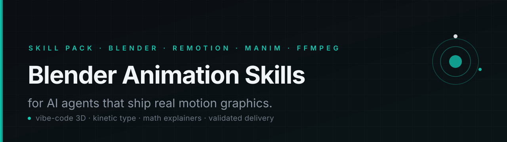

# Blender Animation Skills for AI Agents



**Vibe-code 3D animations, motion graphics, and videos with Claude Code, Codex, Cursor, OpenCode, Gemini CLI, or any coding agent.**

A production-ready skill pack that teaches an AI coding agent to plan, build, preview, inspect, fix, and deliver real animations — Blender 3D scenes, Remotion motion graphics, Manim explainers, and FFmpeg finishing — from a plain-English brief.

<p>
  
  
  
  
</p>

---

## Why this exists

Most "AI animation" attempts fail for one of three reasons:

1. The agent writes a Python script, the render exits `0`, and nobody looks at the result.
2. Every request is forced through one tool — a text explainer gets a 3D scene, a 3D product shot gets CSS.
3. Nothing is reproducible: no storyboard, no preview ladder, no source project, no frame checks.

This pack fixes the process, not just the prompt. It gives an agent the judgment of a creative director, the discipline of a technical director, and the checks of a QC operator.

**You describe the result. The agent chooses the method, builds it, renders previews, inspects frames, revises, and delivers an editable project plus a validated MP4.**

```text
you  →  "10-second cinematic logo reveal, dark, teal accent, slow orbit"
          │
          ▼
      motion-studio  ── routes by scene ──┐
          │                               │
   blender-animation            remotion-motion-graphics
   (3D geometry, light,         (titles, captions, charts,
    camera, particles)           transitions, data)
          │                               │
          └──────────┬────────────────────┘
                     ▼
              video-composition
        (normalize, mix, concat, validate)
                     ▼
              final.mp4 + scene.blend + source + README
```

---

## What's inside

Six composable skills. Install all of them or only the ones you need.

| Skill | What it does | Load it when… |
|---|---|---|
| **[motion-studio](skills/motion-studio/SKILL.md)** | Orchestrator: brief, tool selection, storyboard, preview ladder, QA, delivery | You want a complete video from one sentence |
| **[blender-animation](skills/blender-animation/SKILL.md)** | Headless `bpy`: scene builds, materials, light rigs, camera moves, Geometry Nodes, particles, EEVEE/Cycles, image sequences | The work is spatial 3D |
| **[remotion-motion-graphics](skills/remotion-motion-graphics/SKILL.md)** | React/frame-based video: typography, transitions, charts, captions, data-driven and batch rendering | The work is layout, text, and time |
| **[manim-animation](skills/manim-animation/SKILL.md)** | Math, proofs, graphs, algorithms, precise diagram transformations | Correctness of math is the point |
| **[motion-design](skills/motion-design/SKILL.md)** | Art direction: palette, type scale, timing, easing, transitions, sound, RTL typography | Before building, or when the result feels generic |
| **[video-composition](skills/video-composition/SKILL.md)** | FFmpeg/FFprobe: concat, overlay, alpha, audio mix, loudness, subtitles, platform encodes, validation | Scenes must become one file |

Each skill follows the [Agent Skills](https://opencode.ai/docs/skills/) format (`SKILL.md` + `references/`), so it works anywhere a coding agent can read files and run shell commands.

---

## Install

### One command (macOS / Linux)

```bash
git clone https://github.com/aminghaseminia/blender-animation-skill.git
cd blender-animation-skill
./install.sh                      # auto-detects OpenCode / Claude Code / .agents
# or choose a target:
./install.sh --target ~/.config/opencode/skills
./install.sh --target .opencode/skills        # project-local
```

### Windows (PowerShell)

```powershell
git clone https://github.com/aminghaseminia/blender-animation-skill.git
cd blender-animation-skill
Copy-Item -Recurse skills\* "$env:USERPROFILE\.config\opencode\skills\"
```

### Manual

```bash
mkdir -p ~/.config/opencode/skills
cp -R skills/* ~/.config/opencode/skills/
```

Restart the agent or start a new session. Skills are discovered by their `SKILL.md` frontmatter.

### Where skills live

| Agent | Global | Project-local |
|---|---|---|
| **OpenCode** | `~/.config/opencode/skills/` | `.opencode/skills/` |
| **Claude Code** | `~/.claude/skills/` | `.claude/skills/` |
| **Codex / generic** | `~/.agents/skills/` | `.agents/skills/` |
| **Cursor / Copilot** | follow the tool's rules-file support; `AGENTS.md` at repo root also works | same |

> Install all six as siblings. `motion-studio` refers to its sibling skills by relative path.

---

## Quick start prompts

Paste any of these into your agent after installing.

**3D cinematic**
```text
Use blender-animation. Create a 10-second cinematic product reveal:
a matte-black wristwatch on a dark surface, teal rim light, slow 120°
orbit, shallow depth of field, subtle floor reflection. 1920×1080, 30 fps.
Render a low-res preview first, inspect frames, then a 1080p master.
```

**2D motion graphics**
```text
Use remotion-motion-graphics. Build a 15-second launch video for a
developer tool: dark background, kinetic type, three feature cards
staggering in, an animated counter from 0 to 12,000, ending on the logo
and "Start building". 1080×1920, 30 fps, captions burned in.
```

**Math explainer**
```text
Use manim-animation. Explain why the derivative of x² is 2x with a
geometric limit animation, 60 seconds, restrained palette, Inter labels.
Preview at low quality first.
```

**Hybrid (the usual best answer)**
```text
Use motion-studio. Build a 20-second promo:
- Blender: rotating 3D geometric structure, teal particles forming it
- Remotion: titles, stats, captions, transitions
- FFmpeg: mix music, encode 16:9 and 9:16
Storyboard first, one style frame, previews before finals.
```

**Full pipeline audit**
```text
Use motion-studio. Audit my environment, install only what is missing,
then build a 3-second test animation in each available engine and show me
the renders before we start the real project.
```

---

## How it works

Every substantial request follows the same loop:

| Phase | Output |
|---|---|
| **Understand** | `brief.md` — message, audience, duration, format, assumptions |
| **Select** | tool choice per scene, with a reason |
| **Design** | `storyboard.md`, `style-guide.md`, one style frame |
| **Build** | modular, deterministic, named source files |
| **Preview** | stills → key frames → motion test → full low-res preview |
| **Inspect** | actual rendered frames: clipping, type, timing, continuity |
| **Revise** | smallest affected scenes only |
| **Validate** | `ffprobe`, black/freeze detection, audio peak, playback |
| **Deliver** | final media + editable project + asset manifest + report |

The agent is explicitly instructed **not** to equate "render command exited 0" with "the animation looks right", and to state clearly when visual inspection was not possible.

---

## Defaults the skills enforce

- 1920×1080 landscape, 1080×1920 vertical, 30 fps unless told otherwise.
- Deterministic animation: frame-derived state, seeded randomness, no wall-clock timing.
- H.264 MP4 (`yuv420p`, `+faststart`) for delivery; high-quality intermediates for compositing.
- Image sequences for long or fragile 3D renders.
- One accent colour, one type system, one motion language.
- Easing with intent; stillness as a design element.
- Licences checked for fonts, music, footage — and for Remotion itself.
- Editable source is part of the deliverable, not an afterthought.

---

## Requirements

| Tool | Needed for | Notes |
|---|---|---|
| **Python 3.9+** | running the doctor and helper scripts | system Python is fine |
| **Blender 3.6+ / 4.x** | 3D | `bpy` runs inside Blender only |
| **Node.js 20/22 LTS** | Remotion | `npm` or `pnpm` |
| **FFmpeg 5+ / 8** | all video delivery | needs `libx264` for H.264 |
| **uv** | Manim (optional) | isolated Python env |
| **TeX Live / MiKTeX** | Manim `MathTex` (optional) | only for equations |

Check your machine:

```bash
python3 skills/motion-studio/scripts/doctor.py
python3 skills/motion-studio/scripts/doctor.py --required blender,ffmpeg,node
```

The doctor is read-only. The agent installs only what the project actually needs — it will not bulk-install Blender, Node, TeX, and five other tools because they appear in a list.

---

## Repository structure

```text
blender-animation-skill/
├── README.md
├── LICENSE
├── AGENTS.md
├── install.sh
├── CONTRIBUTING.md
├── CHANGELOG.md
├── assets/
│   └── banner.svg
├── docs/
│   ├── AGENT-COMPATIBILITY.md
│   └── PROMPT-COOKBOOK.md
├── examples/
│   └── prompts.md
├── scripts/
│   └── validate_skills.py
├── .github/workflows/validate.yml
└── skills/
    ├── motion-studio/
    │   ├── SKILL.md
    │   ├── references/{TOOL-SELECTION,INSTALLATION,PRODUCTION-PIPELINE,QUALITY-CHECKLIST,TROUBLESHOOTING-AND-SECURITY}.md
    │   ├── templates/{brief,storyboard,style-guide}.md
    │   ├── templates/project-manifest.json
    │   └── scripts/doctor.py
    ├── blender-animation/
    │   ├── SKILL.md
    │   ├── references/{BLENDER-PLAYBOOK,BLENDER-RECIPES}.md
    │   └── scripts/{scene_template.py,render.sh}
    ├── remotion-motion-graphics/
    │   ├── SKILL.md
    │   ├── references/{REMOTION-PLAYBOOK,REMOTION-RECIPES}.md
    │   └── templates/{tokens.ts,AnimatedTitle.tsx,MainVideo.tsx}
    ├── manim-animation/
    │   ├── SKILL.md
    │   └── references/MANIM-PLAYBOOK.md
    ├── motion-design/
    │   ├── SKILL.md
    │   └── references/MOTION-CRAFT.md
    └── video-composition/
        ├── SKILL.md
        ├── references/FFMPEG-COOKBOOK.md
        └── scripts/validate.sh
```

---

## Blender or Remotion? (short answer)

- **Blender** answers *what is it, how is it shaped, how does light fall on it, where is the camera.* Use it for geometry, materials, particles, simulations, product shots, 3D type, cinematic camera moves.
- **Remotion** answers *what is on screen at each frame, how did it enter, what do the numbers say.* Use it for typography, charts, UI demos, captions, templates, data-driven video.
- **Manim** answers *is the math right and can the viewer follow it.* Use it for equations, proofs, graphs, algorithms.
- **FFmpeg** makes them one file.

A typical professional result uses two or three of them, not one. `motion-studio` decides per scene.

---

## FAQ

**Can an AI agent really create a Blender animation?**
Yes. Blender exposes nearly its entire feature set through Python (`bpy`), and it runs headless (`blender -b --python script.py`). The agent writes a build script, renders previews, inspects frames, and iterates. You keep the `.blend` and the script, so it stays editable.

**Do I need to know Python, React, or Blender's UI?**
No. You need to describe the result and give feedback ("slower camera", "warmer light", "less glow"). The agent translates that into parameters and code.

**Is this a Blender MCP server?**
No. It is a skill pack that runs scripts and CLIs. MCP is optional and documented as a convenience, never a dependency — direct script execution is more reproducible and debuggable.

**Does it work with Claude Code, Codex, Cursor, OpenCode, Gemini CLI?**
Yes, if the agent can read files and run shell commands. Copy the skill folders into that agent's skills directory. See [docs/AGENT-COMPATIBILITY.md](docs/AGENT-COMPATIBILITY.md).

**How long does a render take?**
Preview: seconds to a minute. A 10-second EEVEE 1080p shot: minutes. Cycles with volumetrics or simulation at 4K: hours. The skills enforce a preview ladder so you never discover a design problem after a four-hour render.

**Is Remotion free?**
Remotion is source-available, not OSI open source, with tiered licensing. Individuals and eligible small organizations are covered under its current terms; larger/commercial/automation uses may need a paid licence. The skill tells the agent to check https://www.remotion.dev/docs/license/pricing rather than assume.

**Why not just use After Effects?**
AE is excellent and proprietary/UI-centric. Code-first pipelines are reproducible, diffable, batchable, and reviewable by an agent. The pack tells the agent when a GUI-first tool is genuinely justified, and does not pretend code is always better.

**Can it do Persian/Arabic titles?**
Yes, with explicit checks: shaping-capable fonts, RTL direction, mixed-script punctuation, numerals, and — critically — inspection of the rendered frame, because a correct Unicode string can still shape incorrectly.

**Is my footage uploaded anywhere?**
No. Everything runs locally. The pack instructs the agent not to send private material to external services without permission.

**Can I use the output commercially?**
The skills are MIT. Your output depends on your assets: fonts, music, footage, models, and the licences of Blender/Remotion/Manim. The agent records asset sources and licences in the manifest.

---

## Design principles

1. **The user describes the result; the agent chooses the method.**
2. **One tool per job, not one tool for everything.**
3. **A zero exit code is not a quality check.**
4. **Preview before you spend.**
5. **Determinism makes revision possible.**
6. **Restraint is design.**
7. **The editable source is the deliverable.**
8. **Say what you did not verify.**

---

## Contributing

Issues and PRs welcome — new recipes, new engine playbooks, better checks, translations. See [CONTRIBUTING.md](CONTRIBUTING.md). Keep the skills vendor-neutral, tool-honest, and free of project-specific assumptions.

## Licence

MIT — see [LICENSE](LICENSE).

Blender is © Blender Foundation (GPL). Remotion is source-available under its own terms. Manim Community is MIT. FFmpeg is LGPL/GPL depending on build. This pack only contains instructions and helper scripts; it does not redistribute those applications.

---

<p align="center">
  <sub>Built for agents that ship. If this saved you a render, star the repo.</sub>
</p>
